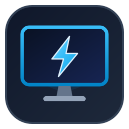

<div align="center">



# DeskBolt

Self-hosted remote desktop, file transfer, and system administration for Windows, Linux, macOS, and Android.

[](https://github.com/jakepanlilio2000/DeskBolt/releases)
[](https://github.com/jakepanlilio2000/DeskBolt/actions/workflows/version-and-release.yml)
[](LICENSE)
[](Cargo.toml)
[](#quick-start)

[Download DeskBolt](https://github.com/jakepanlilio2000/DeskBolt/releases) · [Wiki](https://github.com/jakepanlilio2000/DeskBolt/wiki) · [Changelog](CHANGELOG.md)

</div>

## Core Capabilities

- **Remote desktop.** Control a remote computer, view its screen, or open a file-only session. Switch monitors and synchronize the clipboard over a direct, encrypted connection.
- **Terminal access.** Open an interactive host shell, connect to SSH and serial devices, reuse command snippets, and run a command on multiple saved hosts.
- **Files and logs.** Browse and transfer files, resume interrupted copies, compare directories with exclusion rules, edit remote text files, and follow live logs. Transfers use SHA-256 verification.
- **Network and system administration.** Forward TCP ports, troubleshoot connectivity, and inspect remote systems, processes, and services.
- **Session communications.** Exchange text messages, send desktop alerts, and talk with echo cancellation and noise suppression. Use **System Audio** in the session toolbar to hear host playback with its own volume and mute controls.
- **Power and hardware control.** Restart or shut down an authorized host, send Wake-on-LAN, or use the BIOS console and network boot on compatible hardware.

## Quick Start

System audio is off by default. Enable **Allow System Audio Forwarding** in the host settings, then select **System Audio** in the Viewer toolbar. Set playback defaults under **Tools → Options → Audio & Chat**. Linux requires a compatible desktop audio service in the active session. On macOS 14.6 or later, grant system audio recording permission and select an output device without a microphone.

Install the **Host** on the computer you want to reach and the **Viewer** on the device you will use to connect. Set a host password, then add the host's IP address or DNS name in the viewer. Allow inbound TCP port **4899** on the host firewall if you use the default port.

The first connection shows the host certificate's SHA-256 fingerprint. Confirm it with the host administrator before accepting it. DeskBolt saves the approved fingerprint locally and alerts you if it changes.

### Desktop session controls

- **Cursor Sync** displays the host cursor over the remote desktop. Supported capture backends send its shape and position separately from the screen image.
- **Clipboard → Send Local Clipboard** sends text, PNG images, HTML, or a list of file paths. **Auto-sync clipboard** receives clipboard changes from the active full-control session. Set the size limit under **Options → Display & Input** or with `clipboard_max_bytes` in the host's `config.toml`.
- Drop local files on the remote desktop to upload them to the directory selected in **Files**, or to the host user's Desktop when no directory is selected. Transfer progress appears on the canvas.
- To resume an interrupted copy, reconnect and queue the same source and destination. DeskBolt verifies the retained bytes before resuming. Upload checkpoints are eligible for resume for 24 hours by default.
- In **Compare & Sync**, enter one exclusion rule per line and select **Scan folders**. Both folders use the same rules, such as `target/` to skip build directories and `*.tmp` to skip temporary files.
- **Type Clipboard** sends clipboard text as keystrokes in full-control sessions. The default shortcut is **Ctrl+Shift+V** and the default delay is **10 ms** per character. The shortcut and delay are configurable in **Options**. For firmware consoles and nested desktops, match the target keyboard layout to US scan codes. Unicode entry depends on the target application and input backend.

### Windows

Download the x64 setup executable and select the components you need. When installing the host, set a password during setup. The installer registers and starts the host service.

The ZIP contains standalone binaries. To run the host from the archive, open PowerShell in the extracted directory.

```powershell
.\deskbolt-server.exe --set-password
.\deskbolt-server.exe --console
```

To configure a standalone installation as a service, run `.\deskbolt-server.exe --install` from an elevated PowerShell session. Use `.\deskbolt-server.exe --settings` to manage host preferences.

### Linux

Choose the x86-64 package for your distribution. Install the host and viewer packages you need.

| Distribution | Install command |
| --- | --- |
| Debian, Ubuntu, or Mint | `sudo apt install ./deskbolt-server_*.deb ./deskbolt-viewer_*.deb` |
| Fedora or RHEL | `sudo dnf install ./deskbolt-server-*.rpm ./deskbolt-viewer-*.rpm` |
| openSUSE | `sudo zypper install ./deskbolt-server-*.rpm ./deskbolt-viewer-*.rpm` |
| Arch Linux | `sudo pacman -U ./deskbolt-*.pkg.tar.zst` |

The portable archive contains both binaries in its top-level directory. The AppImage launches the viewer. Make it executable with `chmod +x` before opening it.

```bash
sudo deskbolt-server --set-password
sudo deskbolt-server --install
```

On Wayland, approve the screen-sharing prompt when DeskBolt requests access. For remote input, the host needs access to `/dev/uinput`.

To run the host in your signed-in desktop session, set its password and start it as your user with `deskbolt-server --set-password` and `deskbolt-server --console`. This uses per-user settings and enables desktop alerts, connection approval, and a panel menu on desktops with a compatible system tray. If a host service is already running, stop it or choose another port. Screen blanking needs a desktop that supports it. The blanking overlay can also appear in the remote view.

### macOS

Open the universal disk image and drag **DeskBolt Viewer** into Applications. If you want to host connections, copy `bin/deskbolt-server` from the image to `/usr/local/bin/`.

```bash
sudo /usr/local/bin/deskbolt-server --set-password
sudo /usr/local/bin/deskbolt-server --install
```

In **System Settings → Privacy & Security**, grant the host **Screen Recording** for viewing and **Accessibility** for remote control.

For the menu bar host, run `/usr/local/bin/deskbolt-server --set-password` and `/usr/local/bin/deskbolt-server --console` from your signed-in account. This uses per-user settings and allows local connection approval and desktop alerts. If a host service is already running, stop it or choose another port. To start the host at login, enable **Start host automatically with operating system** in Host Settings. macOS can require additional permission for power actions.

### Android

Install the APK on a device with Android 8.0 or later, then open the viewer and add a host. Tap or drag with one finger to operate the pointer. Use a two-finger tap to right-click and a two-finger drag to scroll. The session toolbar has a virtual keyboard for full-control connections.

To share an Android device, open **DeskBolt Host**, enter a host password, and select **Start Sharing**. Confirm screen capture in the system dialog. For remote control, enable DeskBolt in **Accessibility Settings**. A full-control viewer can drag, long-press, scroll, type into supported fields, and use the **Device** menu for navigation and system actions. Device locking requires Android 9 or later and the host's power permission. Text and HTML clipboard sharing follows the system's clipboard access rules. On recent Android versions, reading local clipboard changes generally requires DeskBolt to have focus. Stop sharing from the host screen or its notification.

## Developer Reference

### Workspace

| Crate | Responsibility |
| --- | --- |
| [`deskbolt-proto`](crates/deskbolt-proto) | Shared framing, authentication, and media codecs |
| [`deskbolt-server`](crates/deskbolt-server) | Host services, screen capture, input, and session handlers |
| [`deskbolt-viewer`](crates/deskbolt-viewer) | Viewer, address book, and administration tools |

### Wire Protocol

TLS 1.3 carries multiplexed frames with a six-byte header. A big-endian 32-bit payload length is followed by one channel byte and one flags byte. Frame payloads are limited to 16 MiB and decompressed payloads to 32 MiB.

| Channel | Contents |
| --- | --- |
| `0x01` | Authentication, session and monitor controls, keepalives, Windows secure attention |
| `0x02` | Screen tiles, video, and cursor updates |
| `0x03` | Keyboard, pointer input, and Android device actions |
| `0x04` | Text, PNG, HTML, and file-list clipboard updates |
| `0x05` | File operations, directory synchronization, and log tailing |
| `0x06` | Host terminal and serial streams |
| `0x07` | Forward and reverse TCP tunnels |
| `0x08` | System, process, and service administration |
| `0x09` | Text chat, desktop alerts, voice, and system audio |
| `0x0A` | Host power actions |

### Build from Source

Use the stable Rust toolchain and install CMake and NASM. On Linux, install the native development dependencies listed in the [Linux build job](.github/workflows/version-and-release.yml).

```bash
cargo test --workspace --all-features --locked
cargo clippy --workspace --all-targets --locked -- -D warnings
cargo build --release --workspace --no-default-features --locked
```

For Android, use Java 17, Android SDK and build tools 35, NDK r27.2.12479018, and Gradle 8.11.1. Install `cargo-ndk` 4.1.2 and the `aarch64-linux-android` and `x86_64-linux-android` Rust targets. Provide `ANDROID_KEYSTORE_FILE`, `ANDROID_KEYSTORE_PASSWORD`, `ANDROID_KEY_ALIAS`, and `ANDROID_KEY_PASSWORD` in the build environment to create a signed APK in `android/app/build/outputs/apk/release/`.

```bash
cargo ndk --target arm64-v8a --target x86_64 --platform 26 \
  --output-dir android/app/src/main/jniLibs \
  build --release --no-default-features --locked -p deskbolt-viewer -p deskbolt-server
gradle -p android assembleRelease
```

## License

DeskBolt is licensed under the [Mozilla Public License 2.0](LICENSE). Copyright © StackSync Solutions.
