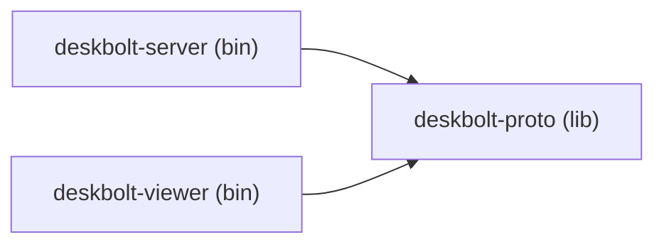
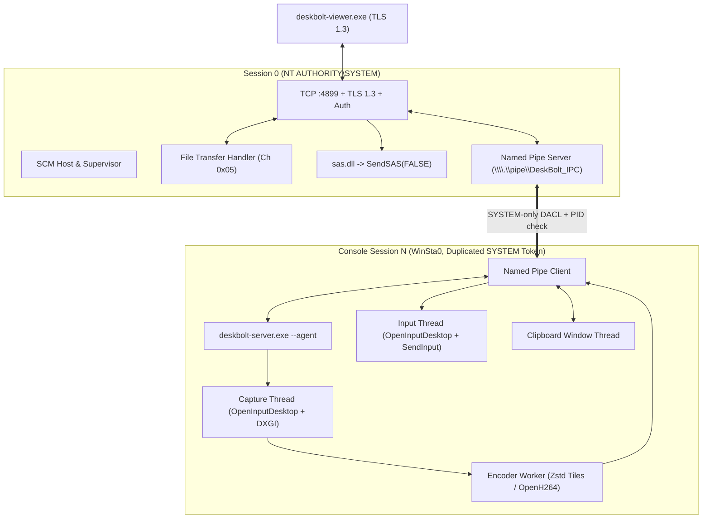
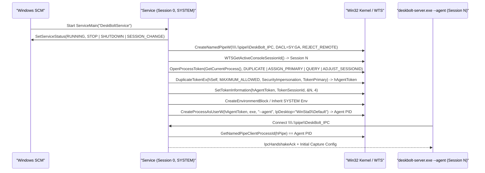

# DeskBolt System Architecture & Crate Boundaries

**Document ID:** `SPEC-ARCH-001`  
**Target Platform:** Windows x86_64 (`x86_64-pc-windows-msvc`), Rust `edition = "2024"`  
**License:** MPL-2.0 (`StackSync Solutions` / `jakepanlilio2000`)

---

## 1. Design Goals & Constraints

DeskBolt is a native, 100% self-hosted remote desktop suite:

1. **Zero External Dependencies:** Direct TCP/TLS 1.3 connections over LAN/VPN/WAN (`4899/TCP`). No cloud brokers, STUN/TURN servers, signaling relays, CDNs, or runtime third-party DLLs.
2. **Full Interactive Windows Desktop Coverage:** Remote operators see and control pre-logon screens, lock screens, `Ctrl+Alt+Del` Secure Attention Sequence (SAS) screens, and elevated User Account Control (UAC) prompts without black screens.
3. **Hybrid Visual Fidelity & Motion Efficiency:** Crisp `4:4:4` pixel-exact updates (`zstd` dirty/moved tiles) for text/POS/admin consoles, combined with hardware-friendly `openh264` streaming for video and fast scrolling.
4. **Minimal Complexity:** Three focused workspace crates with explicit boundaries and concrete structs over speculative plugin layers.

---

## 2. Three-Crate Cargo Workspace Topology

```text
DeskBolt/
├── Cargo.toml                  # Workspace root (resolver = "3", edition = "2024", MPL-2.0)
├── LICENSE                     # Mozilla Public License 2.0
├── docs/                       # Engineering blueprint specifications
└── crates/
    ├── deskbolt-proto/         # Library: wire framing, crypto/TLS, codecs, shared types
    ├── deskbolt-server/        # Binary: SCM service host + Session-N console agent
    └── deskbolt-viewer/        # Binary: native eframe/egui client + SQLite phonebook
```

### 2.1 Crate Dependency Graph & Boundaries



| Crate | Kind | Responsibilities | Explicitly Excluded |
|---|---|---|---|
| `deskbolt-proto` | Library | Binary frame codec (`[u32 len][u8 ch][u8 flags][payload]`), `bincode` 1.3 message schemas, TLS 1.3 `ServerConfig`/`ClientConfig` builders, SHA-256 fingerprint & TOFU verifier, Argon2id + HMAC-SHA256 challenge-response primitives, IP rate limiter, `openh264` & `zstd` tile codec wrappers, `thiserror` protocol errors | Win32 SCM, DXGI capture, `SendInput`, `egui`/`eframe`, SQLite, filesystem transfer execution |
| `deskbolt-server` | Binary (`deskbolt-server.exe`) | Dual-mode executable: (1) Windows Service Control Manager (SCM) host (`NT AUTHORITY\SYSTEM`, Session 0) owning TCP `4899` listener, TLS termination, auth, rate-limiting, `SendSAS`, File Transfer (`0x05`), and Session-0-to-Console supervisor; (2) `--agent` interactive desktop process owning `WinSta0\Default`/`Winlogon` thread binding, DXGI capture, hybrid encoding, `SendInput`, and clipboard sync | GUI frameworks (`egui`/`eframe`), SQLite address book, client UI hooks |
| `deskbolt-viewer` | Binary (`deskbolt-viewer.exe`) | Native desktop GUI (`eframe`/`egui` 0.37), SQLite address book (`phonebook.db` via `rusqlite` `bundled`), TLS 1.3 client with TOFU prompt & fingerprint storage, multi-tab session viewport, `WH_KEYBOARD_LL` system key hook, GPU texture upload (`LINEAR`/`NEAREST`), dual-pane File Transfer UI | Windows Service registration, DXGI capture, `SendInput`, `sas.dll` |

---

## 3. Windows Session-0 to Console-Session Bridging Architecture

### 3.1 The Session-0 Isolation & Secure Desktop Problem

Since Windows Vista, all Windows Services run in **Session 0**, a non-interactive session isolated from the physical display (`WinSta0` in Console Session `N >= 1`). Calling DXGI Desktop Duplication (`IDXGIOutputDuplication`) or `SendInput` directly from Session 0 fails. Furthermore, spawning an interactive helper with the logged-in user's standard token (`WTSQueryUserToken`) causes **black screens and unresponsive mice** whenever:

1. No user is logged in yet (initial boot at `WinSta0\Winlogon`).
2. The workstation is locked (`Win+L`).
3. Windows switches to the **Secure Desktop** (`WinSta0\Winlogon`) for a UAC elevation prompt or `Ctrl+Alt+Del`.

### 3.2 DeskBolt Dual-Process Architecture (`Service` + `--agent`)

DeskBolt solves this with a split-process design running in a **single binary** (`deskbolt-server.exe`):



### 3.3 Exact Session-0 Token Duplication & Spawn Sequence



#### Step-by-Step Win32 Implementation Details

1. **SCM Registration (`windows-service 0.8.1`):**
   - `define_windows_service!` registers `ffi_service_main`.
   - `service_control_handler::register` handles `ServiceControl::Stop`, `ServiceControl::Shutdown`, `ServiceControl::Interrogate`, and `ServiceControl::SessionChange(param)`.
   - Reports `ServiceControlAccept::STOP | ServiceControlAccept::SHUTDOWN | ServiceControlAccept::SESSION_CHANGE`.
2. **Active Console Tracking:**
   - Supervisor maintains `active_session_id: Option<u32>`.
   - Wakes immediately on `ServiceControl::SessionChange` (`ConsoleConnect`, `ConsoleDisconnect`, `SessionLogon`, `SessionLogoff`, `SessionLock`, `SessionUnlock`) OR a 1-second safety poll of `WTSGetActiveConsoleSessionId()`.
   - If `WTSGetActiveConsoleSessionId()` returns `0xFFFFFFFF` (no physical console attached), supervisor waits until a console session appears without spinning CPU.
   - If the active console session ID changes (e.g., Fast User Switching or RDP console takeover), supervisor sends `IpcMsg::Shutdown` over `\\.\pipe\DeskBolt_IPC`, waits up to `1000 ms`, calls `TerminateProcess` if hung, and spawns a new `--agent` in the new session ID.
3. **Self-Token Duplication (Why `SYSTEM` instead of `WTSQueryUserToken`):**
   - `OpenProcessToken(GetCurrentProcess(), ...)` reads the Session-0 service's own `NT AUTHORITY\SYSTEM` token.
   - `DuplicateTokenEx` creates a `TokenPrimary` duplicate (`h_agent_token`).
   - `SetTokenInformation(h_agent_token, TokenSessionId, &console_session_id, 4)` retargets that `SYSTEM` token into Console Session `N`.
   - `CreateProcessAsUserW` launches `deskbolt-server.exe --agent` with `STARTUPINFOW.lpDesktop` set to `"WinSta0\\Default"` (UTF-16), `CREATE_NO_WINDOW | CREATE_UNICODE_ENVIRONMENT`.
   - Because the agent runs **in Session `N` as `SYSTEM`**, it possesses full DACL rights on **both** `WinSta0\Default` and `WinSta0\Winlogon`.
4. **Hardened Named Pipe IPC (`\\.\pipe\DeskBolt_IPC`):**
   - Created by the Session-0 service before calling `CreateProcessAsUserW`.
   - Security descriptor built via `ConvertStringSecurityDescriptorToSecurityDescriptorW("D:(A;;GA;;;SY)")` (grants `GENERIC_ALL` solely to `NT AUTHORITY\SYSTEM`; interactive users and even non-elevated Administrators receive `ERROR_ACCESS_DENIED`).
   - Pipe flags include `PIPE_TYPE_BYTE | PIPE_READMODE_BYTE | PIPE_WAIT | PIPE_REJECT_REMOTE_CLIENTS`.
   - Immediately upon client connection, the service invokes `GetNamedPipeClientProcessId` and verifies `client_pid == spawned_agent_pid`. Any mismatch closes the pipe instance and drops the intruder.
   - Framing on `\\.\pipe\DeskBolt_IPC` reuses `deskbolt-proto`'s `[u32 length BE][u8 channel_id][u8 flags][payload]` framing (`bincode` serialized `IpcControl` + raw encoded video/input frames) so zero extra codec layers exist.

### 3.4 Preventing Black Screens on UAC, Lock Screen, and Logon

Windows isolates UAC Secure Desktop, the lock screen, and the logon UI onto `WinSta0\Winlogon`. Whenever Windows transitions between `WinSta0\Default` and `WinSta0\Winlogon`:

1. Active `IDXGIOutputDuplication` returns `DXGI_ERROR_ACCESS_LOST` (`0x887A0026`) or `DXGI_ERROR_INVALID_CALL` on `AcquireNextFrame`.
2. Dedicated **Capture Thread** (which owns the COM/D3D11/DXGI device — never shared across unrelated threads):
   - Drops the stale `DXGIManager` instance.
   - Calls `OpenInputDesktop(0, FALSE, DESKTOP_READOBJECTS | DESKTOP_WRITEOBJECTS | DESKTOP_CREATEWINDOW | DESKTOP_SWITCHDESKTOP | GENERIC_ALL)`.
   - Queries `GetUserObjectInformationW(h_desk, UOI_NAME, ...)` for diagnostics (e.g., `"Default"` vs `"Winlogon"`).
   - Calls `SetThreadDesktop(h_desk)` and closes the previous desktop handle (`CloseDesktop`).
   - Re-creates `DXGIManager::new(timeout_ms)` bound to the current active monitor index and forces a full-frame refresh (`FLAG_KEYFRAME` / `is_full_refresh = true`).
   - Backoff loop: if `OpenInputDesktop` fails transiently during a desktop switch (`10 ms`–`50 ms`), retry up to 20 times (`20 ms` interval) before reporting `DisplayUnavailable` (e.g., `WinSta0\Disconnect`).
3. Dedicated **Input Thread** (separate OS thread from Capture so `SendInput` never blocks on DXGI wait):
   - Maintains its own current `HDESK` handle.
   - Before processing an input batch (or on a desktop-switch flag signaled by the Capture thread / periodic `OpenInputDesktop` check when idle), compares the active input desktop handle/name and updates via `SetThreadDesktop(h_desk)` before calling `SendInput`.
   - Result: clicking "Yes" on an elevated UAC prompt or typing a Windows password on the lock screen works natively without interruption.

### 3.5 On-Demand Agent Lifecycle & Resource Hygiene

- **Idle Mode (0 connected viewers):** Service still runs TCP listener on `4899`, while `--agent` can either remain parked in low-power idle (zero DXGI polling when `viewer_count == 0`, sleeping on an IPC wake event) OR be spawned only on first authenticated screen/input viewer connection.
- **Chosen Strategy (`ADR-002`):** Spawn `--agent` lazily upon the first authenticated `FullControl` or `ViewOnly` session, keep a 5-second grace idle timer after the last viewer disconnects, and tear down cleanly when idle. File-transfer-only (`FileTransfer`) sessions never spawn `--agent` at all.

---

## 4. Runtime Concurrency Model (Per Component)

### 4.1 `deskbolt-server` Runtime Architecture

- **Async Tokio Multi-Thread Runtime (`tokio 1.54.1`):**
  - `listener_task`: accepts TCP connections, spawns connection handler.
  - `session_task` (one per authenticated viewer): enforces 5s TLS+auth timeout, multiplexes channels `0x01..0x05`, runs bounded outbound priority scheduler.
  - `ipc_supervisor_task`: owns `\\.\pipe\DeskBolt_IPC` duplex async I/O, manages `Watch<SessionTopology>`, fans out decoded video/clipboard frames to active viewing sessions via bounded broadcast/mpsc slots (depth 2 with latest-frame-wins semantics).
- **Blocking OS Threads inside `--agent`:**
  - `capture_thread` (`std::thread`): owns `DXGIManager`, monitors `OpenInputDesktop` / `SetThreadDesktop`, pushes raw BGRA + `FrameMetadata` into a 1-slot overwrite channel (`Mutex<(Option<RawFrame>, Condvar)>`) so slow encoding never backs up DXGI.
  - `encoder_thread` (`std::thread`): pulls latest frame, runs `openh264` or `zstd` level 3 tile compression, writes framed packets to async IPC pipe writer.
  - `input_thread` (`std::thread`): binds to active input desktop, drains `0x03` input events immediately via `SendInput`, enforces sticky-key release on disconnect.
  - `clipboard_thread` (`std::thread`): hidden message-only/agent window running Win32 `GetMessageW` pump with `AddClipboardFormatListener` for bidirectional UTF-8 text clipboard sync (re-binding desktop when `Default` desktop is active).

### 4.2 `deskbolt-viewer` Runtime Architecture

- **Main UI Thread (`eframe` / `egui` 0.37.0):**
  - Owns `AppState`, `PhonebookDb` (synchronous fast queries on startup/search via `rusqlite`), active tab views, and `egui::TextureHandle` per tab.
  - Never performs blocking network or heavy codec work on the UI thread; reads latest decoded RGBA frame from a per-session `Arc<Mutex<Option<DecodedFrame>>>` + atomic `frame_seq` checked on every `update()`.
- **Background Tokio Runtime (`tokio 1.54.1`):**
  - Per-session `net_task`: drives TLS 1.3 stream, handles challenge-response auth, prioritizes outbound `0x03` input & `0x01` control frames, dispatches inbound `0x02` video packets to a dedicated per-session `decode_thread` (`std::thread` / `spawn_blocking` owning `openh264::decoder::Decoder` + persistent RGBA scratch framebuffer for Zstd tile patching), and executes `0x05` file transfers.
  - Calls `egui_ctx.request_repaint()` when new decoded frames, toast events, or file-transfer progress deltas arrive.
- **Optional Keyboard Hook Thread (`std::thread`):**
  - Runs only while a `FullControl` session tab is focused and system-key capture is enabled; hosts `SetWindowsHookExW(WH_KEYBOARD_LL, ...)` with a dedicated Win32 `GetMessageW` loop.

---

## 5. Architecture Decision Records (ADRs)

### ADR-001: Custom TLS 1.3 TCP Framing vs. QUIC/WebRTC
- **Context:** DeskBolt targets 100% self-hosted Windows administration over LAN/VPN/port-forwarded TCP `4899` (single-port architecture).
- **Options Considered:** (A) WebRTC (`webrtc-rs`) with ICE/DTLS; (B) QUIC (`quinn`); (C) TLS 1.3 over TCP (`tokio-rustls`) with prioritized binary mux + latest-frame drop.
- **Decision:** **Option C — TLS 1.3 over TCP `4899`.**
- **Rationale:** Zero NAT/ICE/SDP signaling infrastructure, deterministic single-port firewall traversal (`4899/TCP`), mature `rustls` TLS 1.3 + TOFU verification, and trivial loopback testing. Head-of-line blocking is mitigated at the application mux layer by capping queued video frames at `<= 2`, dropping intermediate P-frames under congestion, and sending IDR/full-tile recovery.
- **Revisit Trigger:** Only if WAN lossy-Wi-Fi packet loss >5% proves TCP stalling unacceptable after Phase 4 benchmarking.

### ADR-002: Lazy `SYSTEM`-Token `--agent` vs. Always-Running Agent or `WTSQueryUserToken`
- **Context:** Service must capture `Winlogon`/UAC desktops while conserving idle CPU/GPU resources.
- **Decision:** **Lazy `SYSTEM`-token `--agent` launched into `WTSGetActiveConsoleSessionId()` on first viewing connection, with 5s idle teardown.**
- **Rationale:** Duplicating the `SYSTEM` token with `TokenSessionId` unlocks both `WinSta0\Default` and `WinSta0\Winlogon` without black screens. Lazy spawn keeps idle RAM/CPU near zero when nobody is viewing.
- **Trade-Off:** ~150ms cold-start latency on the very first viewer connection (mitigated by overlapping TLS/Auth with agent pre-warm on `ClientHello` or accepting 150ms startup).

### ADR-003: Dual-Mode Hybrid Codec (`openh264` + `zstd` Tiles) vs. Pure H.264
- **Context:** H.264 uses `4:2:0` chroma subsampling, which smears 1px ClearType fonts, red/blue terminal text, and POS grids. Pure lossless tiles saturate WAN links during video playback.
- **Decision:** **Hybrid (`zstd` level 3 DXGI dirty/move tiles for static/text/POS + `openh264` I420 streaming for motion), user-selectable with `Auto` heuristic.**
- **Rationale:** Gives pixel-exact `4:4:4` clarity on admin consoles/IDE/POS screens and smooth low-bitrate video when scrolling or playing media.

### ADR-004: Static Single-Binary Deployment Philosophy
- **Decision:** Bundle SQLite (`rusqlite` `bundled`) and `openh264` statically from source; restrict runtime imports to standard Windows system DLLs (`kernel32`, `user32`, `advapi32`, `wtsapi32`, `dxgi`, `d3d11`, `sas`, `crypt32`).
- **Rationale:** Zero installer DLL hell; `deskbolt-viewer.exe` can run completely portable from a USB drive alongside `phonebook.db`, and `deskbolt-server.exe` deploys as a single self-registering executable.
