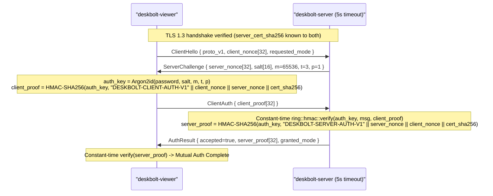

# DeskBolt Security & Cryptography Model

**Document ID:** `SPEC-SEC-003`  
**Crates:** `deskbolt-proto`, `deskbolt-server`, `deskbolt-viewer`  
**Cryptographic Primitives:** `rustls 0.23` (`ring 0.17`), `tokio-rustls 0.26`, `rcgen 0.14.10`, `argon2 0.5`

---

## 1. Threat Model & Trust Boundaries

DeskBolt operates across hostile LANs, VPNs, and direct internet port-forwards with zero trusted third-party CAs or cloud intermediaries:

| Boundary | Threat | Mitigation |
|---|---|---|
| Network Transport | Passive sniffing, active MITM, TLS downgrade | Mandatory **TLS 1.3 only** (`rustls`), ECDSA P-256 server keys, strict **TOFU SHA-256 fingerprint pinning** bound into auth HMAC |
| Authentication | Credential eavesdropping, replay attacks, brute force | Zero plaintext password over the wire: **32-byte random server + client nonces** with **Argon2id + HMAC-SHA256** mutual proof, **5-second** pre-auth timeout, IP rate limiting |
| Privilege / Local IPC | Local unprivileged user hijacking `\\.\pipe\DeskBolt_IPC` to steal screen or inject `SYSTEM` input | Named pipe DACL locked exclusively to `NT AUTHORITY\SYSTEM` (`D:(A;;GA;;;SY)`), `PIPE_REJECT_REMOTE_CLIENTS`, and `GetNamedPipeClientProcessId` verification |
| Session Authorization | `ViewOnly` client sending spoofed `0x03` input or `0x05` file mutations | Server-side mode enforcement prior to IPC dispatch (`ViewOnly` drops/rejects input, clipboard writes, `SendSAS`, and file writes) |
| Host Filesystem | Path traversal (`..\..\Windows\System32\...`), symlink escape during File Transfer | Canonical root/drive validation, traversal segment rejection, `bincode` allocation limits, full-file SHA-256 integrity checks |

---

## 2. Persistent Self-Signed Certificate Generation (`rcgen 0.14.10`)

### 2.1 First-Boot Provisioning

On initial startup, `deskbolt-server` checks `%PROGRAMDATA%\DeskBolt\certs\`:
- Certificate: `%PROGRAMDATA%\DeskBolt\certs\server.crt.pem`
- Private key: `%PROGRAMDATA%\DeskBolt\certs\server.key.pem`

If either file is absent:
1. Build SAN list: `"localhost"`, `"127.0.0.1"`, local machine NetBIOS/FQDN hostname, and discovered non-loopback local interface IPs.
2. Call `rcgen::generate_simple_self_signed(subject_alt_names)?` (which uses `PKCS_ECDSA_P256_SHA256` by default in `rcgen 0.14`).
3. Extract `CertifiedKey { cert, key_pair }`:
   - Write `cert.pem()` to `server.crt.pem`.
   - Write `key_pair.serialize_pem()` to `server.key.pem`.
   - Compute and log the SHA-256 fingerprint (`SHA256(cert.der().as_ref())`) in colon-separated uppercase hex (`AA:BB:CC:...:FF`) so administrators can verify out-of-band before first connection.
4. Set restrictive Windows NTFS ACLs on `%PROGRAMDATA%\DeskBolt\certs\` and `server.key.pem`: grant `Full Control` strictly to `NT AUTHORITY\SYSTEM` and `BUILTIN\Administrators`, disabling inheritance (`PROTECTED_DACL_SECURITY_INFORMATION`) so unprivileged local accounts cannot read the private key.

### 2.2 Certificate Rotation

Administrators can rotate the identity certificate cleanly via `deskbolt-server.exe --regen-cert` (and restart service). Connected/returning Viewers will detect the fingerprint mismatch via TOFU and prompt the operator before trusting the new key.

---

## 3. TLS 1.3 Transport & Viewer TOFU Pinning (`rustls 0.23`)

### 3.1 Strict TLS 1.3 Configuration

- **Provider:** Explicitly install/use `rustls::crypto::ring::default_provider()`.
- **ServerConfig:**
  - `ServerConfig::builder_with_provider(provider).with_protocol_versions(&[&rustls::version::TLS13])`
  - Loads leaf `CertificateDer` and `PrivateKeyDer` from `server.crt.pem` / `server.key.pem`.
  - No client certificate required (`with_no_client_auth()`).
- **ClientConfig:**
  - `ClientConfig::builder_with_provider(provider).with_protocol_versions(&[&rustls::version::TLS13])`
  - Attaches custom `TofuServerCertVerifier` via `.dangerous().with_custom_certificate_verifier(Arc::new(verifier))`.

### 3.2 `TofuServerCertVerifier` Contract

```rust
pub enum TrustDecision {
    /// Fingerprint matches pinned entry in phonebook.db
    TrustedPinned,
    /// First time seeing this host (no pinned fingerprint stored yet)
    FirstUse { fingerprint: [u8; 32] },
    /// Mismatch against pinned fingerprint — hard security block
    Mismatch { expected: [u8; 32], observed: [u8; 32] },
}
```

Inside `rustls::client::danger::ServerCertVerifier`:
1. **`verify_server_cert(end_entity, ...)`:**
   - Computes `observed = ring::digest::digest(&ring::digest::SHA256, end_entity.as_ref())`.
   - Inspects pinned expectation:
     - If pinned matches `observed` -> returns `Ok(ServerCertVerified::assertion())`.
     - If pinned differs -> immediately aborts TLS handshake (`Err(rustls::Error::General("Pinned certificate fingerprint mismatch"))`) and records `observed` so the UI displays the exact Expected vs. Observed mismatch alert.
     - If unpinned -> records `observed` as pending TOFU, completes TLS handshake verification **only to extract/verify signature**, or even safer: computes `observed` during handshake, lets TLS complete into the pre-auth prompt **only if the operator approves the fingerprint in the TOFU modal BEFORE sending any `ClientHello` / `ClientAuth` bytes**, OR aborts the initial probe handshake with `TofuPending(observed)` and reconnects immediately once the user clicks **"Trust & Connect"**!
     - **Chosen Safe Pattern:** Two-step probe-and-verify on unpinned hosts:
       1. Probe TLS handshake verifies the server actually holds the private key matching `end_entity` (`verify_tls13_signature`), records `observed`, and aborts before sending any application data (`Err(TofuConfirmationRequired(observed))`).
       2. Viewer modal presents the host address + SHA-256 fingerprint (`AA:BB:...`) to the user.
       3. Upon user confirmation, Viewer saves (or caches for quick-connect) the fingerprint and opens the authenticated TLS 1.3 connection where `expected == observed`!
       *(Benefit: Zero unapproved bytes ever traverse an untrusted TLS tunnel, and the user never stalls a server's 5-second unauthenticated socket timeout while reading a dialog!)*
2. **`verify_tls13_signature(message, cert, dss)`:**
   - Delegates strictly to `rustls::crypto::verify_tls13_signature(message, cert, dss, &self.supported_algs)` using `ring`'s `signature_verification_algorithms`. This guarantees a MITM cannot present someone else's pinned public certificate without owning the corresponding private key.
3. **`verify_tls12_signature(...)`:**
   - Returns `Err(rustls::Error::PeerIncompatible(PeerIncompatible::Tls12NotOffered))`.

---

## 4. Challenge-Response Authentication (Argon2id + HMAC-SHA256)



### 4.1 Key Derivation & Storage on Server

1. Administrator sets the host password via `deskbolt-server.exe --set-password` (interactive masked console prompt or `--password-stdin` for automated provisioning).
2. Server generates a `16-byte` cryptographic random `argon2_salt` (`ring::rand::SystemRandom`).
3. Derives a `32-byte` `auth_key` using `argon2 0.5`:
   - Algorithm: `Algorithm::Argon2id`, `Version::V0x13`
   - Parameters: `m_cost = 65536` (64 MiB), `t_cost = 3`, `p_cost = 1`, `output_len = 32`
4. Server seals `(argon2_salt, m_cost, t_cost, p_cost, auth_key)` using Windows DPAPI (`CryptProtectData` with `CRYPTPROTECT_LOCAL_MACHINE` + `SYSTEM`-only ACL on `%PROGRAMDATA%\DeskBolt\auth.dat`).
5. **Why Channel Binding Matters:** Including `server_cert_sha256` inside both HMAC transcripts binds the password proof to the exact TLS 1.3 endpoint certificate. Even if an attacker tricks a user into clicking "Trust" on a rogue proxy certificate, the proxy cannot forward the `client_proof` to the legitimate server because `cert_sha256` differs.
6. **Memory Hygiene:** Zeroize temporary `password` and `auth_key` buffers immediately after computing `client_proof` on the Viewer. Never store plaintext passwords or `auth_key` in `phonebook.db`.

---

## 5. Pre-Auth Timeouts & Anti-Brute-Force Rate Limiting

### 5.1 5-Second Unauthenticated Socket Timeout

Every accepted TCP connection is wrapped in:
```rust
tokio::time::timeout(Duration::from_secs(5), authenticate_connection(stream, ...))
```
This covers:
- TLS 1.3 handshake (`ClientHello` -> `Finished`)
- Receiving `0x01::ClientHello`
- Sending `0x01::ServerChallenge`
- Receiving `0x01::ClientAuth` and verifying `client_proof`

If 5 seconds elapse before `AuthResult { accepted: true }` is sent, the socket is dropped immediately, freeing the connection slot and preventing slowloris resource exhaustion. Additionally, cap concurrent unauthenticated handshakes at `MAX_PREAUTH_CONNS = 32`.

### 5.2 Per-IP Rate Limiter

- **IP Normalization:** Convert IPv4-mapped IPv6 addresses (`::ffff:192.168.1.50`) to canonical `IpAddr::V4(192.168.1.50)` so dual-stack sockets cannot bypass limits.
- **Bounded State:** In-memory table capped at `4096` IP entries (evicting oldest expired records) to prevent memory-exhaustion DoS under spoofed source floods.
- **Backoff Schedule:**
  - Failures `1..=2`: allowed immediately (cooldown `0s`).
  - Failure `3`: `2s` cooldown.
  - Failure `4`: `5s` cooldown.
  - Failure `5`: `15s` cooldown.
  - Failure `>= 6` within a `10-minute` sliding window: `60s` lockout (`retry_after_secs = remaining`), rejected immediately after TLS/ClientHello (or before Argon2/HMAC verification) with `AuthResult { accepted: false, retry_after_secs }`.
- **Reset on Success:** A valid `client_proof` clears that IP's failure counter.

---

## 6. Secure Attention Sequence (`SendSAS`) & Input Isolation

### 6.1 `Ctrl+Alt+Del` Injection via `sas.dll`

Windows strictly blocks synthesized `Ctrl+Alt+Del` via `SendInput`. DeskBolt implements official SAS injection inside the Session-0 `NT AUTHORITY\SYSTEM` service:

1. Validate active session has `SessionMode::FullControl`.
2. Verify/ensure Windows policy registry key:
   - `HKLM\SOFTWARE\Microsoft\Windows\CurrentVersion\Policies\System`
   - Value `SoftwareSASGeneration` (`REG_DWORD`) = `1` (Services) or `3` (Services and Ease of Access). Configured automatically during `deskbolt-server.exe --install`.
3. Dynamically load `sas.dll` from `System32` (`LOAD_LIBRARY_SEARCH_SYSTEM32` flag to prevent DLL search-order hijacking):
   - Resolve `SendSAS: unsafe extern "system" fn(BOOL)` (note: `SendSAS` returns `()` / `VOID`).
   - Invoke `SendSAS(FALSE)` (because the caller is a `SYSTEM` Windows Service, `asUser = FALSE`).
4. Windows transitions Console Session `N` to `WinSta0\Winlogon`; the Session-`N` `--agent` immediately rebinds via `OpenInputDesktop` + `SetThreadDesktop` and streams the SAS screen cleanly.

### 6.2 Input Isolation & Stuck-Key Prevention

- **Pressed-Key Tracker:** Server tracks active pressed keys (`HashSet<(u16, bool)>` of `(scan_code, extended)`) per `FullControl` session.
- **Disconnect / Focus-Loss Cleanup:** When a session disconnects, drops, or switches to `ViewOnly`, the agent immediately synthesizes `KEYEVENTF_KEYUP` for every still-depressed key (especially `Ctrl`, `Alt`, `Shift`, `LWin`/`RWin`) on the active input desktop so the host never remains locked with a stuck modifier key.
- **Exclusive Input Arbitration:** If multiple viewers connect simultaneously (default cap: `4` concurrent viewers), input events execute cleanly; optional host config `single_controller_lock` allows only the first `FullControl` session to drive input while others observe in `ViewOnly`.
