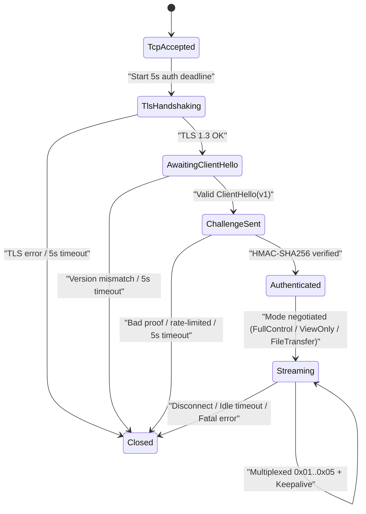
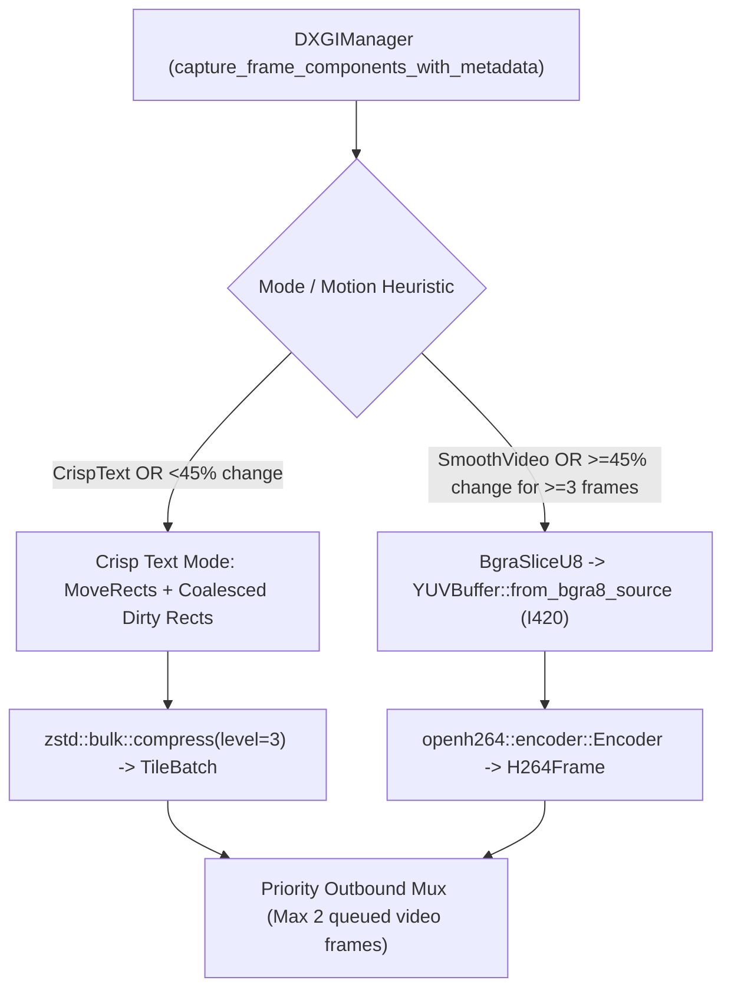

# DeskBolt Binary Wire Protocol & Hybrid Video Pipeline

**Document ID:** `SPEC-PROTO-002`  
**Crate:** `crates/deskbolt-proto`  
**Transport:** TLS 1.3 over TCP port `4899` (and local IPC `\\.\pipe\DeskBolt_IPC`)

---

## 1. Binary Frame Layout

Every packet across both the TLS 1.3 TCP socket and the local IPC named pipe uses the same 6-byte fixed header followed by an arbitrary binary payload:

```text
 0                   1                   2                   3
 0 1 2 3 4 5 6 7 8 9 0 1 2 3 4 5 6 7 8 9 0 1 2 3 4 5 6 7 8 9 0 1
+-+-+-+-+-+-+-+-+-+-+-+-+-+-+-+-+-+-+-+-+-+-+-+-+-+-+-+-+-+-+-+-+
|                        length (u32 BE)                        |
+-+-+-+-+-+-+-+-+-+-+-+-+-+-+-+-+-+-+-+-+-+-+-+-+-+-+-+-+-+-+-+-+
|  channel_id   |     flags     |                               |
+-+-+-+-+-+-+-+-+-+-+-+-+-+-+-+-+                               +
|                     payload (length bytes)                    |
+---------------------------------------------------------------+
```

### 1.1 Header Field Definitions

| Offset | Size | Type | Name | Description |
|---|---|---|---|---|
| `0` | 4 bytes | `u32` (Big-Endian) | `length` | Byte length of `payload` ONLY (excludes the 6-byte header). Valid range: `0 ..= MAX_FRAME_PAYLOAD` (`16 * 1024 * 1024` = 16 MiB). Frames with `length > 16 MiB` MUST trigger immediate connection abort (`ProtocolError::FrameTooLarge`). |
| `4` | 1 byte | `u8` | `channel_id` | Logical multiplexed stream ID (`0x01`..`0x05`). Unknown channel IDs MUST return `ProtocolError::UnknownChannel`. |
| `5` | 1 byte | `u8` | `flags` | Bitmask of frame attributes (see §1.3). |
| `6` | `length` bytes | `[u8]` | `payload` | `bincode 1.3` serialized message (or Zstd-compressed `bincode` payload if `FLAG_COMPRESSED` is set, with bounded deserialization limits). |

### 1.2 Channel Registry

| Channel ID | Name | Priority | Direction | Allowed Session Modes |
|---|---|---|---|---|
| `0x01` | `Auth / Control` | `1` (High) | Bidirectional | All (`Handshake`, `FullControl`, `ViewOnly`, `FileTransfer`) |
| `0x02` | `Video / Tiles` | `3` (Normal) | Server -> Viewer | `FullControl`, `ViewOnly` |
| `0x03` | `Input` | `0` (Highest) | Viewer -> Server | `FullControl` ONLY (dropped/rejected in `ViewOnly` & `FileTransfer`) |
| `0x04` | `Clipboard` | `2` (Medium) | Bidirectional | Server -> Viewer in `FullControl`/`ViewOnly`; Viewer -> Server in `FullControl` ONLY |
| `0x05` | `FileTransfer` | `4` (Bulk) | Bidirectional | `FileTransfer` (and concurrent File Transfer window from an authenticated `FullControl` session) |

### 1.3 Flags Bitmask (`u8`)

| Bit | Mask | Constant | Semantics |
|---|---|---|---|
| 0 | `0x01` | `FLAG_COMPRESSED` | Entire `payload` is Zstd-compressed prior to `bincode` decoding (bounded decompress cap: `32 MiB`). Unused on `0x02` where tiles/H.264 manage their own inner encoding. |
| 1 | `0x02` | `FLAG_KEYFRAME` | On channel `0x02`: packet is an H.264 IDR keyframe or a full-screen Zstd refresh (`TileBatch.is_full_refresh == true`). Enables fast drop/recovery on slow links. |
| 2 | `0x04` | `FLAG_END_OF_STREAM` | Marks final chunk/control notification for a transfer stream or graceful session teardown. |
| 3 | `0x08` | `FLAG_URGENT` | Expedited scheduler hint (used for `SendSas`, `ReleaseAllKeys`, `KeyframeRequest`, and active `Input`). |
| 4..7 | `0xF0` | `RESERVED` | Must be `0` in protocol version `1`. |

### 1.4 Serialization Guardrails (`bincode 1.3`)

All structured payloads use deterministic `bincode::DefaultOptions`:
```rust
bincode::DefaultOptions::new()
    .with_fixint_encoding()
    .allow_trailing_bytes() // or reject_trailing_bytes() for strict validation
    .with_limit(MAX_DECODE_ALLOCATION)
```
We enforce `.reject_trailing_bytes()` and `.with_limit(16 * 1024 * 1024)` on wire decoding so malformed or adversarial length prefixes inside `Vec<u8>`/`String` fields cannot trigger multi-gigabyte OOM allocations.

---

## 2. Protocol State Machine



### 2.1 Mode-Based Capability Enforcement (Server Trust Boundary)

| Incoming Client Message | `FullControl` | `ViewOnly` | `FileTransfer` |
|---|---|---|---|
| `0x01` `Ping` / `MonitorSelect` / `QualityPreset` / `KeyframeRequest` / `Disconnect` | Allowed | Allowed | Allowed (`Ping`, `Disconnect` only) |
| `0x01` `SendSas` (`Ctrl+Alt+Del`) | Allowed | **Rejected** (`ErrorCode::PermissionDenied`) | **Rejected** |
| `0x03` `Input` (`Mouse*`, `KeyEvent`, `ReleaseAllKeys`) | Allowed | **Rejected / Ignored** | **Rejected** |
| `0x04` `ClipboardText` (Viewer -> Server) | Allowed | **Rejected** | **Rejected** |
| `0x05` `FileTransfer` | Allowed (if host permits concurrent FT) | **Read-only disabled unless mode upgraded** | Allowed |

---

## 3. Channel Message Catalog

### 3.1 Channel `0x01` — Auth & Control (`ControlMsg`)

```rust
pub enum SessionMode {
    FullControl = 0,
    ViewOnly = 1,
    FileTransfer = 2,
}

pub enum VideoQualityMode {
    Auto = 0,
    CrispText = 1,
    SmoothVideo = 2,
}

pub struct MonitorInfo {
    pub id: u8,
    pub name: String,
    pub is_primary: bool,
    pub left: i32,
    pub top: i32,
    pub width: u32,
    pub height: u32,
    pub dpi_scale: f32,
}
```

| Tag | Variant | Direction | Payload Fields |
|---|---|---|---|
| `0` | `ClientHello` | C -> S | `proto_version: u16 (1)`, `client_nonce: [u8; 32]`, `requested_mode: SessionMode`, `client_name: String` |
| `1` | `ServerChallenge` | S -> C | `server_nonce: [u8; 32]`, `argon2_salt: [u8; 16]`, `argon2_m_kib: u32`, `argon2_t: u32`, `argon2_p: u32` |
| `2` | `ClientAuth` | C -> S | `client_proof: [u8; 32]` |
| `3` | `AuthResult` | S -> C | `accepted: bool`, `server_proof: [u8; 32]`, `granted_mode: SessionMode`, `retry_after_secs: u16`, `reason: String` |
| `4` | `MonitorList` | S -> C | `monitors: Vec<MonitorInfo>`, `active_monitor_id: u8` |
| `5` | `MonitorSelect` | C -> S | `monitor_id: u8` |
| `6` | `ResolutionChange` | S -> C | `monitor_id: u8`, `width: u16`, `height: u16`, `dpi_scale: f32` |
| `7` | `QualityPreset` | C -> S | `mode: VideoQualityMode`, `target_fps: u8` (`1..=60`), `h264_bitrate_kbps: u32` |
| `8` | `SendSas` | C -> S | `{}` (triggers `SendSAS(FALSE)` in Session-0 service) |
| `9` | `KeyframeRequest` | C -> S | `monitor_id: u8` |
| `10` | `SessionStatus` | S -> C | `desktop_state: DesktopState` (`Interactive` / `SecureWinlogon` / `Disconnected`), `message: String` |
| `11` | `Ping` | Bi | `timestamp_ms: u64` (sent every `10s`; idle disconnect if no response for `30s`) |
| `12` | `Pong` | Bi | `timestamp_ms: u64` |
| `13` | `FrameAck` | C -> S | `last_seq: u64`, `decode_ms: u16` (used for adaptive pacing) |
| `14` | `SessionModeSwitch` | C -> S | `mode: SessionMode` (allows toggling `FullControl` <-> `ViewOnly` in-session without reconnecting) |
| `15` | `Disconnect` | Bi | `reason: String` |

### 3.2 Channel `0x02` — Video / Tiles (`VideoMsg`)

```rust
pub struct MoveRect {
    pub src_x: u16,
    pub src_y: u16,
    pub dst_x: u16,
    pub dst_y: u16,
    pub width: u16,
    pub height: u16,
}

pub struct DirtyTile {
    pub x: u16,
    pub y: u16,
    pub width: u16,
    pub height: u16,
    pub zstd_bgra: Vec<u8>, // zstd level 3 compressed raw tightly-packed BGRA8 (width * height * 4 bytes uncompressed)
}
```

| Tag | Variant | Payload Fields |
|---|---|---|
| `0` | `H264Frame` | `monitor_id: u8`, `frame_seq: u64`, `timestamp_us: u64`, `width: u16`, `height: u16`, `is_keyframe: bool`, `annex_b: Vec<u8>` |
| `1` | `TileBatch` | `monitor_id: u8`, `frame_seq: u64`, `timestamp_us: u64`, `width: u16`, `height: u16`, `is_full_refresh: bool`, `move_rects: Vec<MoveRect>`, `tiles: Vec<DirtyTile>` |
| `2` | `CursorUpdate` | `visible: bool`, `x: i16`, `y: i16`, `hotspot_x: u16`, `hotspot_y: u16`, `width: u16`, `height: u16`, `zstd_rgba_shape: Option<Vec<u8>>` |

### 3.3 Channel `0x03` — Input (`InputMsg`)

| Tag | Variant | Payload Fields | Notes |
|---|---|---|---|
| `0` | `MouseMoveAbs` | `norm_x: f32`, `norm_y: f32` | Normalized `[0.0, 1.0]` within active monitor bounds; mapped to virtual desktop `0..=65535` on server |
| `1` | `MouseButton` | `button: MouseBtn` (`Left/Right/Middle/X1/X2`), `down: bool`, `norm_x: f32`, `norm_y: f32` | Includes normalized position to prevent click-position race |
| `2` | `MouseWheel` | `delta_x: i16`, `delta_y: i16` | Multiples of `WHEEL_DELTA` (`120`) |
| `3` | `KeyEvent` | `scan_code: u16`, `vk_code: u16`, `down: bool`, `extended: bool` | Hardware scan code (`MAPVK_VK_TO_VSC_EX`) preferred for `SendInput` (`KEYEVENTF_SCANCODE`), preserving `KEYEVENTF_EXTENDEDKEY` for Right Ctrl/Alt, Arrows, Win, Nav cluster |
| `4` | `ReleaseAllKeys` | `{}` | Synthesizes `KEYEVENTF_KEYUP` for all tracked depressed modifiers/keys |

### 3.4 Channel `0x04` — Clipboard (`ClipboardMsg`)

| Tag | Variant | Payload Fields |
|---|---|---|
| `0` | `SetText` | `seq: u64`, `utf8_text: String` (hard-capped at `2 MiB` UTF-8 per update; loop-prevention via `seq` / content hash check) |
| `1` | `Clear` | `seq: u64` |

### 3.5 Channel `0x05` — File Transfer (`FileMsg`)

| Tag | Variant | Direction | Payload Fields |
|---|---|---|---|
| `0` | `ListRootsReq` | C -> S | `{}` (returns Windows logical drives `C:\`, `D:\`, etc.) |
| `1` | `ListRootsResp` | S -> C | `roots: Vec<DriveEntry>` (`letter: String`, `label: String`, `free_bytes: u64`, `total_bytes: u64`) |
| `2` | `ListDirReq` | C -> S | `path: String` |
| `3` | `ListDirResp` | S -> C | `path: String`, `entries: Vec<FileEntry>` (`name: String`, `is_dir: bool`, `size: u64`, `modified_unix: i64`, `readonly: bool`) |
| `4` | `MkdirReq` | C -> S | `path: String` |
| `5` | `MkdirResp` | S -> C | `ok: bool`, `error: Option<String>` |
| `6` | `DeleteReq` | C -> S | `path: String`, `recursive: bool` |
| `7` | `DeleteResp` | S -> C | `ok: bool`, `error: Option<String>` |
| `8` | `RenameReq` | C -> S | `from_path: String`, `to_path: String` |
| `9` | `RenameResp` | S -> C | `ok: bool`, `error: Option<String>` |
| `10` | `TransferStart` | Bi | `transfer_id: u64`, `direction: TransferDir` (`Upload`/`Download`), `remote_path: String`, `total_bytes: u64`, `modified_unix: i64`, `overwrite: bool` |
| `11` | `TransferStartAck` | Bi | `transfer_id: u64`, `accepted: bool`, `exists: bool`, `existing_size: u64`, `existing_modified_unix: i64`, `error: Option<String>` |
| `12` | `FileChunk` | Bi | `transfer_id: u64`, `offset: u64`, `chunk_seq: u32`, `data: Vec<u8>` (raw `<= 65536` bytes; optional Zstd if compressible, indicated by `FLAG_COMPRESSED`) |
| `13` | `FileAck` | Bi | `transfer_id: u64`, `acked_seq: u32` (sliding window flow control: max 8 unacked chunks = `512 KiB`) |
| `14` | `FileComplete` | Bi | `transfer_id: u64`, `total_bytes: u64`, `sha256: [u8; 32]` |
| `15` | `FileVerifyResult` | Bi | `transfer_id: u64`, `verified: bool`, `error: Option<String>` |
| `16` | `FileAbort` | Bi | `transfer_id: u64`, `reason: String` |

---

## 4. Hybrid Dual-Mode Capture & Video Pipeline



### 4.1 Crisp Text / POS Mode (`zstd` Level 3 + DXGI Dirty/Moved Rects)

1. Capture via `DXGIManager::capture_frame_components_with_metadata()` returning `(raw_bgra, (width, height), metadata: FrameMetadata)`.
2. Extract `metadata.move_rects` and `metadata.dirty_rects`:
   - Clamp all rects safely to `(0..width, 0..height)`.
   - Merge adjacent/overlapping dirty rects when union waste `< 25%` to avoid hundreds of tiny headers on text typing; split rects larger than `256x256` only if memory slicing helps (or send coalesced bounding rects directly since `zstd` level 3 compresses at >400 MB/s).
   - For each dirty rect `(x, y, w, h)`, copy tightly-packed `w * h * 4` BGRA bytes into a reusable scratch buffer and compress with `zstd::bulk::compress(&scratch, 3)`.
   - Skip sending a `TileBatch` if `move_rects.is_empty() && tiles.is_empty()` (`CaptureError::Timeout` -> idle zero bandwidth!).
3. **Viewer Reconstruction:**
   - Persistent `framebuffer: Vec<u8>` (`width * height * 4` RGBA8).
   - First apply `move_rects` via row-safe overlap copy (`memmove` semantics using a temp slice if `src` and `dst` overlap).
   - Next decompress each `DirtyTile` with `zstd::bulk::decompress(&tile.zstd_bgra, expected_bytes)`, swizzle `BGRA -> RGBA` (`[b, g, r, a] -> [r, g, b, 255]`) into `(tile.x, tile.y, tile.width, tile.height)` of `framebuffer`.
   - Upload `ColorImage` to `egui::TextureHandle`. Zero chroma loss; 1px ClearType text remains 100% pixel-identical to the host.

### 4.2 Motion Mode (`openh264` 0.9.10)

1. Convert raw BGRA frame via `openh264::formats::BgraSliceU8::new(&raw_bgra, (width, height))` -> `YUVBuffer::from_bgra8_source(bgra_source)`.
2. Encode using `openh264::encoder::Encoder` configured with:
   - Explicit resolution matching `(width, height)` (must be even dimensions; pad bottom/right by 1px with black if an exotic monitor reports an odd dimension, cropping back on viewer display).
   - Rate control: configurable bitrate (default `4_000_000 bps` LAN / `1_500_000 bps` WAN), max FPS `30`–`60`, `intra_frame_period` (e.g. `120` frames) + immediate `encoder.force_intra_frame()` on initial connection, mode switch, resolution change, or congestion recovery.
3. Viewer decodes Annex-B stream using `openh264::decoder::Decoder::decode(&frame.annex_b)`, extracting Y/U/V planes into RGBA8 via integer BT.601/BT.709 conversion into `framebuffer`.

### 4.3 `Auto` Heuristic Hysteresis

To prevent rapid codec thrashing:
- **Metrics per captured frame:** `dirty_ratio = sum(dirty_rect_area) / (width * height)`.
- **Switch `CrispText -> SmoothVideo`:** When `dirty_ratio >= 0.45` for `3` consecutive frames within `250 ms`, emit an `H264Frame` IDR keyframe and enter `SmoothVideo`.
- **Switch `SmoothVideo -> CrispText`:** When `dirty_ratio <= 0.10` for `15` consecutive frames OR `500 ms` elapses with `CaptureError::Timeout` (screen settled), emit **one full-frame or last-dirty `TileBatch`** (`is_full_refresh = true` or accumulated dirty region since last H.264 IDR) so crisp text snaps cleanly back to lossless `4:4:4`!

---

## 5. Multi-Monitor, Coordinate Mapping & Dynamic Resolution Renegotiation

### 5.1 Multi-Monitor Enumeration & Selection

- Agent enumerates monitors via Win32 `EnumDisplayMonitors` / DXGI outputs (`IDXGIFactory1` -> `IDXGIAdapter1` -> `IDXGIOutput` `GetDesc`), pairing each `DXGIManager` output index `id: u8` with `MonitorInfo { id, name, is_primary, left, top, width, height, dpi_scale }`.
- Upon session start (and on `WM_DISPLAYCHANGE`), server broadcasts `MonitorList` on `0x01`.
- Viewer selects a monitor via `MonitorSelect { monitor_id }`; agent switches `DXGIManager::set_capture_source_index(monitor_id as usize)`, forces an immediate `ResolutionChange` + full keyframe/tile refresh.

### 5.2 Virtual Desktop Input Mapping

Because secondary monitors can have negative coordinates (e.g., monitor to the left of primary has `left = -1920`) and different DPI scales:
- Viewer converts cursor coordinates inside the rendered remote texture rect to normalized `[0.0, 1.0]` (`norm_x`, `norm_y`).
- Server maps `(norm_x, norm_y)` using the selected `MonitorInfo` + Win32 virtual screen metrics (`SM_XVIRTUALSCREEN`, `SM_YVIRTUALSCREEN`, `SM_CXVIRTUALSCREEN`, `SM_CYVIRTUALSCREEN`):
  - `abs_px_x = monitor.left as f64 + norm_x as f64 * (monitor.width as f64 - 1.0)`
  - `abs_px_y = monitor.top as f64 + norm_y as f64 * (monitor.height as f64 - 1.0)`
  - `win_x = ((abs_px_x - v_left) * 65535.0 / (v_width - 1.0).max(1.0)).round().clamp(0.0, 65535.0) as i32`
  - `win_y = ((abs_px_y - v_top) * 65535.0 / (v_height - 1.0).max(1.0)).round().clamp(0.0, 65535.0) as i32`
- `SendInput` uses `MOUSEEVENTF_MOVE | MOUSEEVENTF_ABSOLUTE | MOUSEEVENTF_VIRTUALDESK`.

### 5.3 Dynamic Resolution Renegotiation

- When `DXGIManager` returns `DXGI_ERROR_MODE_CHANGED` or `capture_frame_components_with_metadata` returns new `(w, h)` != current `(w, h)`:
  1. Agent updates `MonitorInfo` geometry and recreates `openh264::encoder::Encoder` for the new dimensions.
  2. Server sends `ControlMsg::ResolutionChange { monitor_id, width, height, dpi_scale }` on `0x01`.
  3. Server follows immediately with `TileBatch { is_full_refresh: true }` or `H264Frame { is_keyframe: true }`.
  4. Viewer reallocates its `framebuffer` and replaces/resizes its `egui::TextureHandle` cleanly without black flashes.

---

## 6. Backpressure, Priority Scheduling & Frame-Drop Rules

1. **Capture-to-Encode Bounded Slot (Depth = 1):** If the encoder thread is still busy compressing frame `N`, frame `N+1` overwrites the pending raw slot. Wait-free latency; never queues stale frames.
2. **Per-Session Outbound Mux Queue Limits:**
   - `0x03` Input & `0x01` Control: bounded `256` messages, strict priority dequeued before video/file data.
   - `0x02` Video: bounded **`2` frames**. When full:
     - **If new frame is `H264Frame` (delta P-frame):** drop intermediate delta frame and mark `force_next_keyframe = true` once queue drains below `1`, preventing broken reference prediction.
     - **If new frame is `TileBatch`:** instead of blindly dropping dirty regions (which would leave visual holes!), merge the dropped tile's dirty bounding rect into a `pending_dirty_union` list inside the session sender so the next transmitted `TileBatch` re-captures and paints the missed pixels cleanly.
   - `0x05` FileTransfer: sliding window `<= 8` unacked chunks (`512 KiB`) per active transfer; yields whenever `0x01`/`0x02`/`0x03` have queued packets so file transfers never freeze mouse input or video frames.
3. **Slow-Link Frame Pacing:** Viewer includes `decode_ms` in `FrameAck`. If RTT/mux queue delay exceeds `150 ms`, server steps capture target cadence down (`60 -> 30 -> 15 -> 8 fps`) and steps back up automatically when queues clear.
